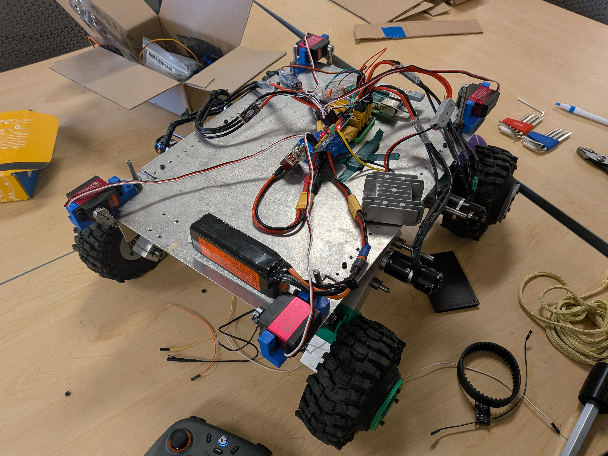

# definity summer robot

**A robot built for Definity Education's summer program that completes a rough obstacle course involving intaking and outtaking tennis balls, a cone slalom, a (very steep!) hill, and a final FRC-style climb.**

*check out [this little demo video](https://youtu.be/MxVGQ_CLmW8) if you wanna see it in action!*

This robot is made out of off-the-shelf parts ordered online, sheet metal pieces from a machine shop, the products of two tortured Bambu Lab X1Cs, and exactly four (4) square metal beams from Home Depot. Before this program, I didn't know how to use OnShape or CAD, use a 3D printer, order things of Amazon and put them together, design for sheet metal, work with a machine shop, and overall how to make something for a problem without a clear solution. This project taught me all of that!

I made this robot with two other teens over the course of 6 weeks for [Hack Club's Stardance](https://stardance.hackclub.com) and of course [Definity's 2026 Summer Program](https://www.definityeducation.org/summer-program). Please check out both of these programs if you are a teenager interested in hardware or software development at all!!
